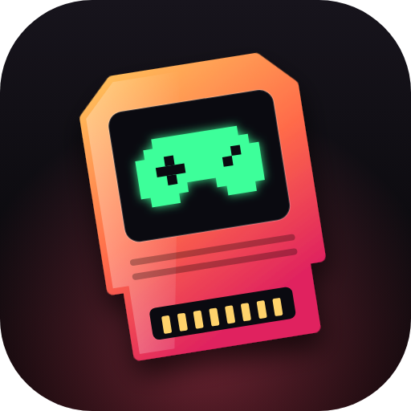
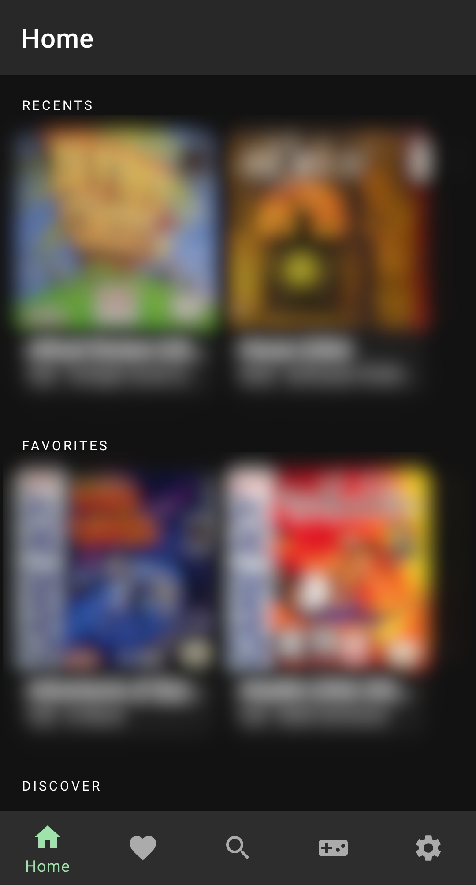
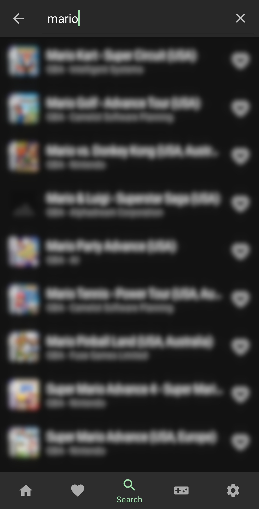
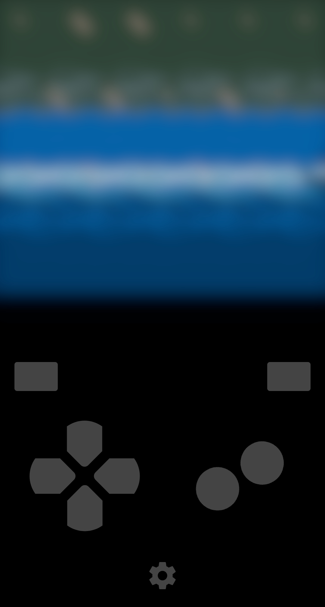

<div align="center">



# OMINOY

**A focused, open-source Game Boy emulator for Android.**
GB · GBC · GBA — powered by Libretro and mGBA.


[Features](#-features) · [Supported systems](#-supported-systems) · [Screenshots](#-screenshots) · [Custom thumbnails](#-custom-thumbnails) · [Reliability](#-reliability) · [Building](#-building)

</div>

---

## 📸 Screenshots

<div align="center">



</div>

---

## ✨ About

OMINOY is an open-source Android emulation app built on Libretro. It focuses exclusively on Nintendo Game Boy, Game Boy Color, and Game Boy Advance; other systems are not supported.

It originated from a branch of [Retrograde](https://github.com/retrograde/retrograde-android) and integrates [LibretroDroid](https://github.com/Swordfish90/LibretroDroid).

## 🎮 Supported systems

| System | Core |
| :-- | :-- |
| Game Boy (GB) | mGBA |
| Game Boy Color (GBC) | mGBA |
| Game Boy Advance (GBA) | mGBA |

## ✅ Completed feature checklist

- [x] Game Boy (GB), Game Boy Color (GBC), and Game Boy Advance (GBA) emulation using mGBA
- [x] ROM scanning and indexing, in-app search, and favorites
- [x] ZIP-compressed ROM support
- [x] Automatic save-RAM and save-state handling, with quick save/load slots
- [x] Per-game cheat-code management for supported systems and code types
- [x] Custom per-game thumbnails from the Android gallery or file picker
- [x] Customizable on-screen controls, gamepad input, tilt input, and local multiplayer
- [x] Screen filters, HD display options, LCD/CRT simulation, and viewport alignment (center, top, bottom, or custom)
- [x] Android phone and Android TV support
- [x] Per-game playtime, session count, and last-played information
- [x] In-app link to OMINOY's GitHub updates

## Planned features

- [ ] More shader options and presets
- [ ] RetroAchievements integration
- [ ] Additional app themes

## 🖼️ Custom thumbnails

Long-press a game tile and choose **Set custom thumbnail** to select artwork from the Android gallery or file picker.

- The image is center-cropped to a square and resized to a maximum of **512 × 512 pixels**.
- A private copy is stored by the app.
- Use **Change thumbnail** or **Remove thumbnail** from the same context menu to manage existing artwork.
- Thumbnails persist across restarts and library rescans.
- They are not embedded in ROM files and are removed when the app is uninstalled.

## 🛡️ Reliability

- **Safe ZIP extraction:** rejects absolute and traversal paths, and applies entry-count, output-size, per-entry-size, and compression-ratio limits.
- **Validated core installs:** core assets are extracted into a validated temporary directory before installation.
- **Sanitized files:** save, state, preview, and cache filenames are sanitized, and applicable file writes are atomic.
- **Careful cleanup:** library cleanup runs only after a complete successful provider scan, preserving existing entries when a provider fails or becomes unavailable.

## 🔧 Building

**Requirements:** JDK 21, Android SDK Platform 35, Android Build Tools 34.0.0, and the repository submodules.

To build the Free Dynamic debug APK, create a throwaway debug-only keystore (do not use it for a production release) and run:

```bash
keytool -genkeypair -noprompt -keystore debug.keystore \
  -storepass android -alias androiddebugkey -keypass android \
  -dname "CN=Android Debug,O=Android,C=US" -keyalg RSA -keysize 2048 -validity 10000
./gradlew assembleFreeDynamicDebug
```

> [!NOTE]
> The debug APK uses a `.debug` application ID suffix and installs separately from a production release. In the Free Dynamic build, mGBA is downloaded on demand when first needed, so internet access may be required.

### Release builds

Create an ignored `keystore.properties` file with `storeFile`, `keyAlias`, `storePassword`, and `keyPassword` entries.

> [!WARNING]
> Never commit a production keystore or its password.

---

<div align="center">

Built on [Retrograde](https://github.com/retrograde/retrograde-android) and [LibretroDroid](https://github.com/Swordfish90/LibretroDroid).

</div>
