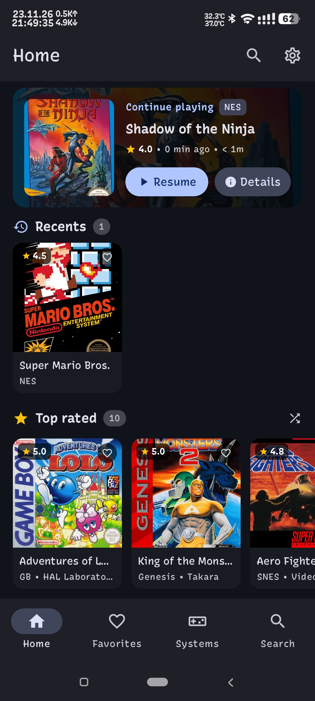
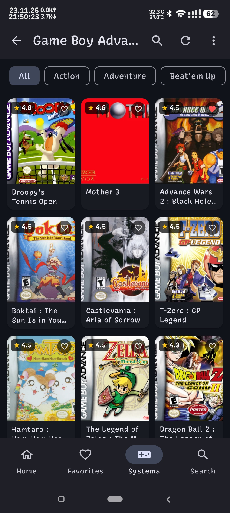
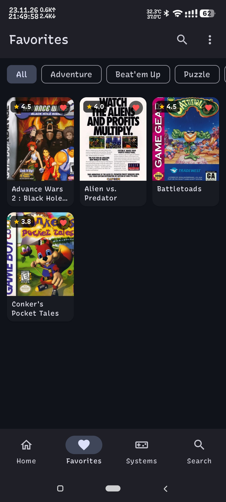
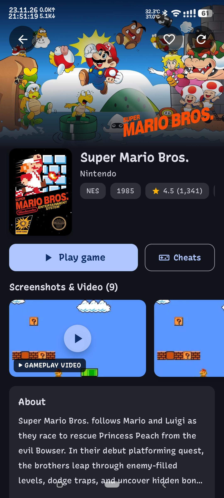
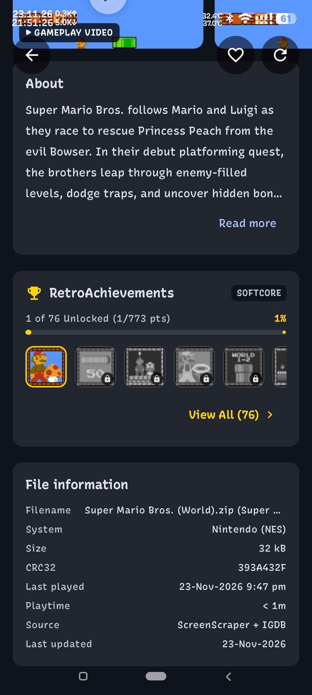
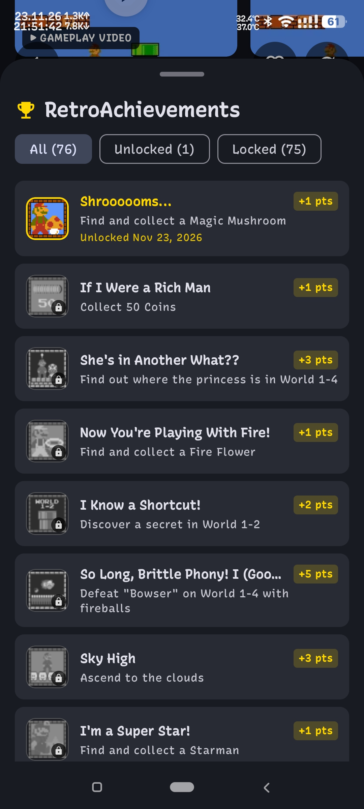
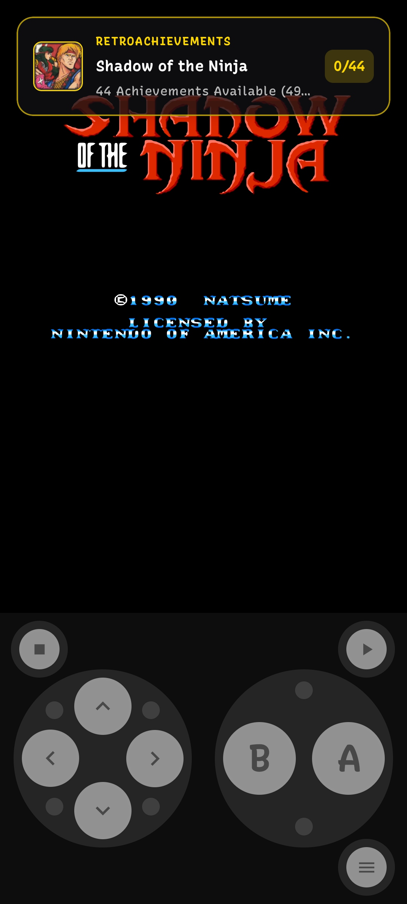
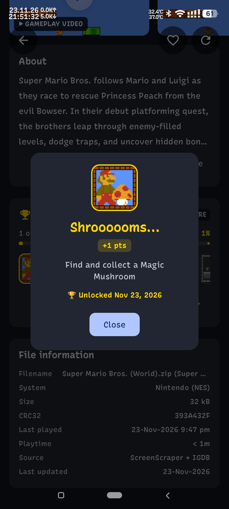
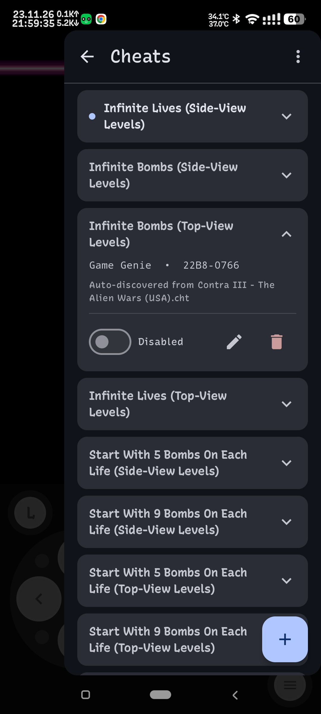
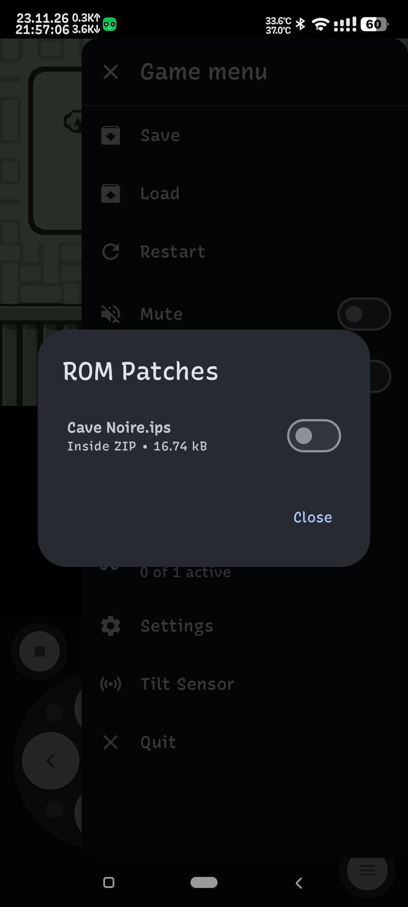

# AlphaLemuroid 🚀

[](https://android.com)
[](LICENSE)
[](https://kotlinlang.org)
[](https://retroachievements.org)

**AlphaLemuroid** is an enhanced feature-rich fork of [Lemuroid](https://github.com/Swordfish90/Lemuroid) adding missing features like RetroAchievements Support, Game Artwork & Media scraping, Multi-Folder ROM storage, Built-in Cheats, IPS Patching and a Modernized UI.

---

## 📸 Screenshots

|  |  |  |
|:---:|:---:|:---:|
| **Continue Playing & Home** | **Grid View & Genre Filters** | **Favorites & Filter Chips** |

|  |  |  |
|:---:|:---:|:---:|
| **Rich Game Details & Media** | **RA Progress & File Info** | **Expandable Achievements Sheet** |

|  |  |  |  |
|:---:|:---:|:---:|:---:|
| **In-Game Unlock Banner** | **Achievement Details Modal** | **In-Game Cheat Manager** | **In-Game ROM Patches** |

---

## 🌟 Key Features & Changelog

### 1. RetroAchievements Tracking Support

* **Native C++ Engine:** Integrated the official `rcheevos` C library directly into our native LibretroDroid core

* **Strict Hardcore Mode Enforcement:**
  * **Save States & Load States:** Fully disabled in the pause menu and hotkeys.
  * **Auto-Save Bypassed:** Auto-save serialization and boot-time state restores are disabled.
  * **Slot Saves Blocked:** Manual slot operations are denied with an on-screen warning toast.
  * **Cheats & Rewind Disabled:** Native cheat injection and rewind buffers are strictly locked out during Hardcore gameplay.

* **Rich UI & Progression:**
  * **Game Details Badge Row:** Horizontal scrolling shelf displaying high-res unlocked and locked badge icons directly from RetroAchievements.
  * **Expandable Bottom Sheet:** Draggable bottom sheet with unlock timestamps, progress indicators and point counters.
  * **Animated In-Game Notification Banner:** Banner displaying badge, achievement title, points and trophy icon upon unlocking an achievement.

---

### 🎨 2. Modern UI Revamp & Home Screen

* **Continue Playing Hero Card:**
  * Large spotlight card on the Home screen for the game you're currently playing.
  * Displays the game cover, system tag, rating, when you last played and total playtime.
  * One-tap Resume to jump straight back into the game or Details to open its info page.

* **Rich Game Info Page:**
  * Dedicated game detail screen with banners, logo wheels, release year, developer/publisher, user ratings and full synopsis.
  * Media gallery to browse screenshots, title screens and watch gameplay videos.
  * File info card displaying disk path, file size, ROM CRC32 checksum, metadata source and total playtime.

* **Custom Collections & Dynamic Shelves:**
  * Create, rename and manage custom collections directly from the Home screen.
  * Top rated shelf featuring a Shuffle button to rotate through your highest-rated titles.
  * Discover shelf to highlight unplayed gems from your library.

* **Library Statistics Overview:**
  * Quick-stats pill on Home showing total games, systems, played count and offline media size.
  * Dialog featuring played/scraped progress bars, total playtime and a sorted games-by-system distribution chart.

---

### 🌐 3. High-Performance Metadata & Offline Media Scraper

* **3 Scraping Modes:**

  * **Mixed (Default):** Queries ScreenScraper and IGDB in parallel and merges missing descriptions, genres, ratings and artwork.
  * **ScreenScraper:** Exclusively uses ScreenScraper metadata and media.
  * **IGDB:** Exclusively uses IGDB metadata and media.

* **Customizable Media Types:**
  * Choose box art style (2D, 3D).
  * Selectively download: Box Art, Hero Banners, Fanarts, Logo Wheels, Gameplay Screenshots, Title Screens and Gameplay Videos.

* **Background Batch Scraping & Dual Notifications:**
  * Scrape individual systems or entire libraries in the background via WorkManager.

* **Offline Media Storage Manager:**
  * Local Recalbox-style directory structure (`<externalFilesDir>/media/<system>/<type>/`).
  * Interactive Media storage settings screen with collapsible per-system dropdowns to view and delete specific media categories individually.

---

### 🎮 4. System Games, Favorites & Search

* **Grid View & List View:**
  * Switch between a modern 3-column grid and classic list view via the 3-dot menu (`⋮`).

* **Multi-Select Genre Filtering:**
  * Multi-select genre tags in Games and Favorites to easily filter your library.

* **Deep Metadata Search:**
  * Search your library by game titles, filenames, developer name, publisher, genres, release year, synopsis and ROM CRC32 hash.

* **Sort Options:**
  * Sort by Name (A–Z / Z–A), Recently Played, Most Played, Highest Rated, Most Rated (highest user rating count) or Release Date.

---

### 📁 5. Multi-Folder ROM Storage

* **Multiple Storage Directories:**
  * Add multiple independent ROM directories across internal storage and external SD cards.

---

### ⚡ 6. Cheats, IPS Patching & Gameplay Tweaks

* **Configurable Fast-Forward Speeds:**
  * Long-press the Fast-Forward row in the in-game pause menu to select 2x, 3x, 4x or 5x.
  * Configure default speed globally under **Settings → General → Fast-forward speed**.

* **Native Cheat Support & Automatic .cht Detection:**
  * Built-in cheat injection for NES, SNES, Game Boy, Game Boy Color and Game Boy Advance.
  * Automatically detects .cht cheat files in your ROM folder ( e.g. GameName.cht for GameName.zip) as well as any .cht files inside .zip archives.
  * Import and export standard .cht files.

* **In-Game IPS ROM Patching:**
  * Built-in IPS patch engine that applies ROM hacks directly without altering your original ROM.
  * Automatically detects .ips patch files in your ROM folder ( e.g. GameName.ips for GameName.zip) as well as any .ips files inside .zip archives.
  * Manage active patches via the pause menu with instant reload support.

* **Playtime Tracking:**
  * Automatically records total playtime per game across sessions.

---

## 🕹️ Supported Systems

| System | Core |
|---|---|
| **Nintendo Entertainment System (NES)** | [fceumm](https://docs.libretro.com/library/fceumm/) |
| **Super Nintendo (SNES)** | [snes9x](https://docs.libretro.com/library/snes9x/) |
| **Game Boy (GB)** | [gambatte](https://docs.libretro.com/library/gambatte/) |
| **Game Boy Color (GBC)** | [gambatte](https://docs.libretro.com/library/gambatte/) |
| **Game Boy Advance (GBA)** | [mgba](https://docs.libretro.com/library/mgba/) |
| **Nintendo 64 (N64)** | [mupen64plus](https://docs.libretro.com/library/mupen64plus/) |
| **Nintendo DS (NDS)** | [desmume](https://docs.libretro.com/library/desmume/) / [melonDS](https://docs.libretro.com/library/melonds/) |
| **Nintendo 3DS (3DS)** | [citra](https://docs.libretro.com/library/citra/) |
| **Sega Genesis / Mega Drive (MD / GEN)** | [genesis_plus_gx](https://docs.libretro.com/library/genesis_plus_gx/) |
| **Sega Master System (SMS)** | [genesis_plus_gx](https://docs.libretro.com/library/genesis_plus_gx/) |
| **Sega Game Gear (GG)** | [genesis_plus_gx](https://docs.libretro.com/library/genesis_plus_gx/) |
| **Sega CD (SCD)** | [genesis_plus_gx](https://docs.libretro.com/library/genesis_plus_gx/) |
| **Sony PlayStation (PSX)** | [PCSX-ReARMed](https://docs.libretro.com/library/pcsx_rearmed/) |
| **Sony PlayStation Portable (PSP)** | [ppsspp](https://docs.libretro.com/library/ppsspp/) |
| **Arcade (FBNeo)** | [fbneo](https://github.com/libretro/FBNeo/) |
| **Atari 2600 / 7800 / Lynx** | [stella](https://docs.libretro.com/library/stella/) / [prosystem](https://docs.libretro.com/library/prosystem/) / [handy](https://docs.libretro.com/library/handy/) |
| **PC Engine / TurboGrafx-16 (PCE)** | [beetle_pce_fast](https://docs.libretro.com/library/beetle_pce_fast/) |
| **Neo Geo Pocket / Color (NGP / NGPC)** | [mednafen_ngp](https://docs.libretro.com/library/beetle_neopop/) |
| **WonderSwan / Color (WS / WSC)** | [beetle_cygne](https://docs.libretro.com/library/beetle_cygne/) |

---

## 📋 TODO

- [ ] **Complete App Backup and Restore:** One-click backup and restoration of all user data, game saves, save states, collections, cheats and scraped offline media.

- [ ] **Custom Shaders Import:** Support for importing external Libretro shader presets and custom CRT/LCD display filters.

---

## 🛠️ Building from Source

### Prerequisites
* Android Studio Ladybug | 2024.2.1 or newer
* Android SDK (API Level 34) & NDK (26.1.10909125)
* JDK 17

### Build Commands
Clone the repository with submodules:
```bash
git clone --recurse-submodules https://github.com/BetterCallShiv/Lemuroid.git
cd Lemuroid
```

Build the debug APK:
```bash
./gradlew :lemuroid-app:assembleAlphaFreeDynamicDebug
```

Build the release APK:
```bash
./gradlew :lemuroid-app:assembleAlphaFreeBundleRelease
```

---

## 🤝 Acknowledgements & Credits

* **[Swordfish90](https://github.com/Swordfish90)** for the original [Lemuroid](https://github.com/Swordfish90/Lemuroid) and [LibretroDroid](https://github.com/Swordfish90/LibretroDroid) projects.
* **[RetroAchievements](https://retroachievements.org)** and the `rcheevos` team for their C library.
* **[Libretro](https://www.libretro.com/)** and core maintainers for cross-platform emulation backends.
* **[Hasheous](https://hasheous.org/)**, **[ScreenScraper](https://www.screenscraper.fr/)**, and **[IGDB](https://www.igdb.com/)** for ROM identification, metadata, and media assets.

---

## 👨‍💻 Author

**Shivam Raj** ([@BetterCallShiv](https://github.com/BetterCallShiv))
- Email: [bettercallshiv@gmail.com](mailto:bettercallshiv@gmail.com)
- GitHub: [github.com/BetterCallShiv](https://github.com/BetterCallShiv)
